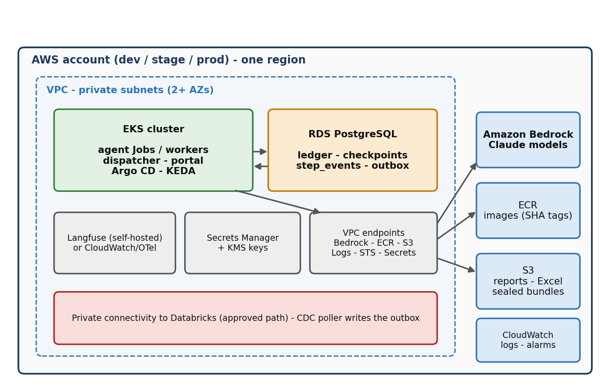
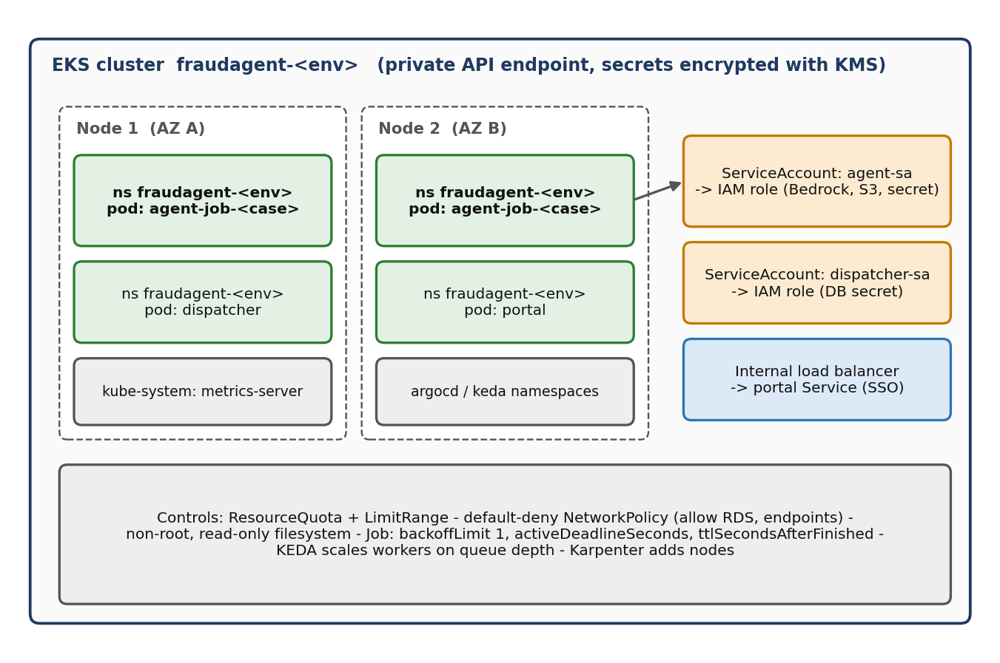
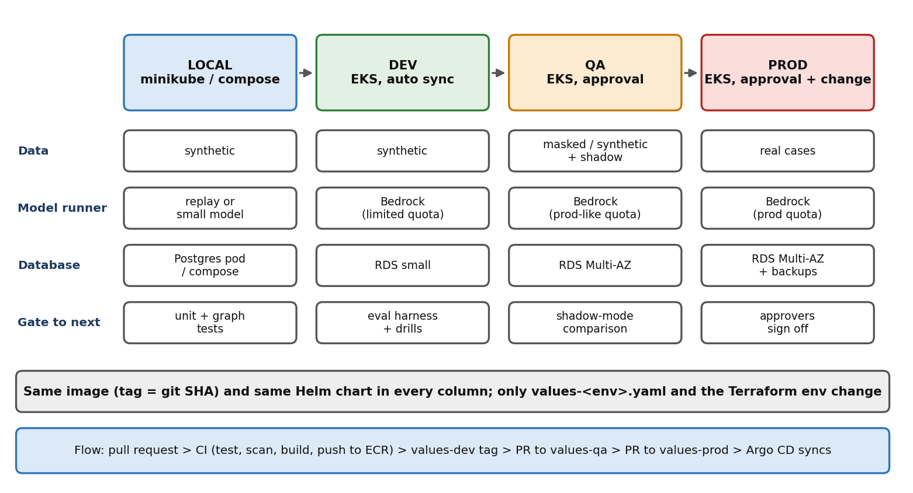

# eks-aws — Conductor agent platform (master reference repo)

Standard template for taking a LangGraph agent from **local → dev → qa → prod** on **ECR + EKS** with **Helm, Terraform, Argo CD** and GitHub Actions. Use this repo as the starting point for each new agent.

> **Status — read this first.** Verified here: the Python app and its 3 unit tests pass; YAML files parse. **Not yet validated** (tools not available when written): Helm templates (`helm lint`), Terraform (`terraform validate`/`plan`), the dispatcher against a real cluster, and the CI workflows. Placeholders to fill: `ACCOUNT_ID`, `REPLACE-*` bucket/table names, VPC and subnet IDs, Bedrock model IDs. `poller.py` is a stub (raises NotImplementedError), `portal.py` is a placeholder server, and the BAU stage bodies in `app/pipeline/stages.py` are skeletons.

## Context
Business-as-usual fraud investigation runs in Claude Code on production data: 24–27+ hours per case, ~460 control defects. Goal: re-implement as a LangGraph pipeline with code-owned control flow, a durable Postgres ledger, bounded loops and timeouts.

Flow: Databricks CDC → incident commander plans/segments → serial segment checks vs personas (create persona if none fits) → census → freeze → ≥3–4 votes → red team → bugs loop back to commander (re-plan, capped) → PUBLISH / PUBLISH WITH CAVEAT / HOLD (hold can re-run, capped) → SHA-256 seal → Excel → publish to custodian. *The exact order of census/freeze/red-team/voting is a config list pending confirmation.*

Constraints: Bedrock only in production; synthetic data only outside the approved bank environment; secrets never in git or images.

## Architecture



- A CronJob polls Databricks Change Data Feed (watermark in Postgres) and writes `case_outbox` rows (unique per case + data version).
- The dispatcher turns outbox rows into Kubernetes **Jobs** (one per case; `backoffLimit 1`, deadline, TTL).
- Agent pods run the LangGraph graph; every step is written ledger-first (idempotent) so a crash resumes instead of restarting.
- Argo CD syncs the cluster from git. It does **not** react to data; the poller does.

## Environment ladder


Same image (tag = git SHA, immutable) and same Helm chart everywhere; only `helm/conductor/values-<env>.yaml` and `terraform/envs/<env>` differ. Details: [docs/promotion-flow.md](docs/promotion-flow.md). CI/CD picture: [d5](docs/images/d5_cicd.png).

## Repo layout
```
app/                 graph.py + cli.py (starter), pipeline/ (BAU stage skeletons), config/pipeline.yaml, personas/, prompts/,
                     dispatcher.py, poller.py (stub), portal.py (stub), schema.sql, tests
Dockerfile, docker-compose.yml, Makefile
helm/conductor/      chart + values-{local,dev,qa,prod}.yaml
k8s/local/           throwaway Postgres for minikube
argocd/              AppProject + Applications (dev auto-sync, qa/prod manual)
terraform/modules/   ecr rds s3 eks iam_policies iam_pod_identity iam_irsa
terraform/envs/      dev qa prod (ECR is created in dev only and shared)
.github/workflows/   ci (test+build+push), promote (tag-bump PR), terraform (validate+plan)
scripts/             local-up.sh, promote.sh, create-db-secret.sh, init-db.sh
docs/                runbook.md, new-agent-template.md, master-reference.md, Word runbook, access-requests, promotion-flow, images
```

## Quick start (local, no AWS, no model)
```bash
make test                       # 4 tests
make run                        # runs the graph with MODEL_RUNNER=replay
docker compose up --build       # app + Postgres
./scripts/local-up.sh           # minikube + helm with values-local.yaml (checks kubectl context first)
```
Local with a real model (synthetic data only, needs approval): `MODEL_RUNNER=anthropic ANTHROPIC_MODEL_ID=<id> ANTHROPIC_API_KEY=... make run`.

## Moving to AWS (outline)
1. Fill the access sheet ([docs/access-requests.md](docs/access-requests.md)).
2. Create the Terraform state bucket + lock table; edit `backend` blocks and `*.tfvars`.
3. `terraform -chdir=terraform/envs/dev init && plan -var-file=dev.tfvars`, review, apply.
4. Install Argo CD on the cluster; `kubectl apply -f argocd/`.
5. Create the DB secret `conductor-db` (key `url`) from the RDS secret; never commit it.
6. Merge to main → image in ECR → run **promote** for dev. Repeat qa, prod with gates.

## Docs
- **Start here: [docs/execution-order.md](docs/execution-order.md)** — everything below in order of execution
- [docs/aws-setup.md](docs/aws-setup.md): IAM, Pod Identity/IRSA, RDS Postgres, Bedrock access
- [docs/environment-testing-and-migration.md](docs/environment-testing-and-migration.md): how to test and migrate at each stage
- [docs/prod-readiness-checklist.md](docs/prod-readiness-checklist.md): what prod-grade needs, by gate
- [docs/master-reference.md](docs/master-reference.md): runbook for all targets (EKS, AgentCore), limits, costs, open items
- [docs/Conductor_Infrastructure_Setup_Runbook.docx](docs/Conductor_Infrastructure_Setup_Runbook.docx): infra setup, requests, diagrams

## Safety rules
Check `kubectl config current-context` before any apply/delete. No real case data outside the approved environment. Shadow mode before limited live use. Preserve the stalled BAU run's evidence.
